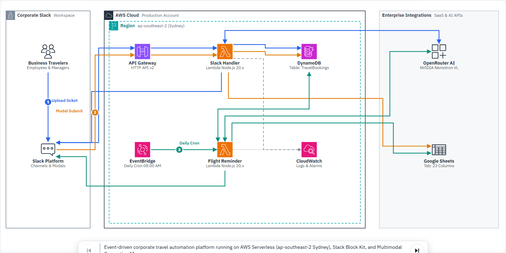
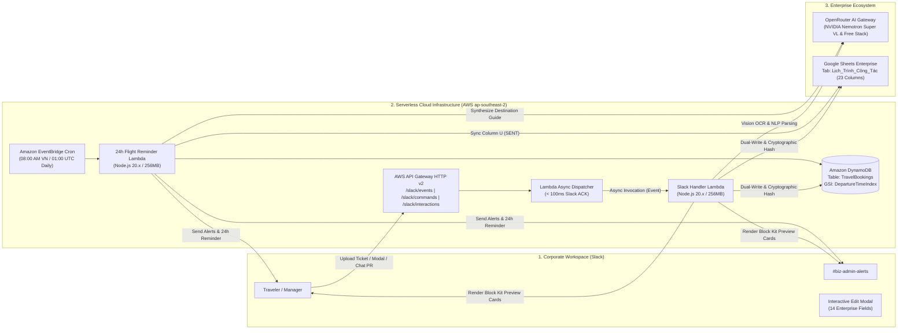
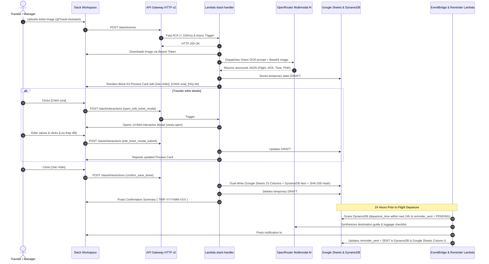
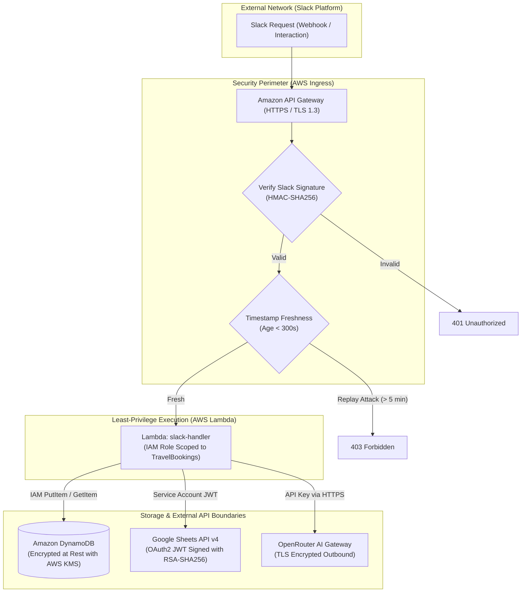

# Smart Travel Assistant: Enterprise Corporate Travel Automation Platform

> **Turn fragmented business travel into automated, audit-proof workflows — on a serverless, zero-idle-cost AWS architecture powered by Multimodal Generative AI.**

[](https://aws.amazon.com/)
[](https://nodejs.org/)
[](https://www.terraform.io/)
[](https://api.slack.com/)
[](https://developers.google.com/sheets/api)
[](LICENSE)

---

## Architecture Overview



> **Architecture Diagram (AWSketch Records Mode):**
> * **Interactive Web View:** Open [smart-travel-assistant.html](docs/diagrams/smart-travel-assistant/smart-travel-assistant.html) to interactively inspect node details, step-by-step traffic timeline, and component cards.
> * **Vector Source:** [smart-travel-assistant.svg](docs/diagrams/smart-travel-assistant/smart-travel-assistant.svg) (Standalone self-contained vector diagram).
> * **Architecture Records:** Verified via [smart-travel-assistant.sources.md](docs/diagrams/smart-travel-assistant/smart-travel-assistant.sources.md) (SHA-256 fingerprints) and [smart-travel-assistant.decisions.md](docs/diagrams/smart-travel-assistant/smart-travel-assistant.decisions.md).
> * **Visual Verification:** Automated screenshot and pixel validation executed via Playwright Chromium (`npm run test:visual`).

<details>
<summary><b>Click to expand Text Flowchart (Mermaid)</b></summary>



</details>

---

## Table of Contents
1. [Problem Statement](#1-problem-statement)
2. [Proposed Solution](#2-proposed-solution)
3. [End-to-End Workflow](#3-end-to-end-workflow)
4. [AWS Service Responsibilities](#4-aws-service-responsibilities)
5. [Networking & Security](#5-networking--security)
6. [Cost Analysis (FinOps)](#6-cost-analysis-finops)
7. [Automated Testing & QA Verification](#7-automated-testing--qa-verification)
8. [Quick Start & Deployment](#8-quick-start--deployment)

---

## 1. Problem Statement

Corporate travel in growing organizations (50 to 500+ employees) routinely faces administrative chaos. Employees book flights across disparate travel sites, forwarding confirmations to overflowing email inboxes or posting screenshots into private team chats. This creates five persistent operational bottlenecks:

* **Fragmented Ticket Ingestion & Manual Data Re-entry:** Operation and HR staff spend hours transcribing boarding passes, e-tickets, and booking confirmations into spreadsheets. Transcriptions suffer from typos, inconsistent airline naming, misspelled passenger names, and missing itinerary details.
* **Lack of Itinerary Standardization & Audit Trails:** Shared corporate spreadsheets (Google Sheets / Excel) lack strict data validation contracts. Columns are accidentally deleted, IATA airport codes are mixed with raw city names, date formats vary (`DD/MM` vs `MM/DD`), and unprinted ticket prices default to misleading zeros (`0 VND`), distorting financial reporting.
* **High Barrier to Employee Adoption:** Traditional corporate travel suites (SAP Concur, Navan) require rigid 5-page enterprise ERP forms with heavy credential management. Employees circumvent these systems because they disrupt their daily workflow.
* **Passive Calendaring vs. Proactive Employee Preparation:** A standard 15-minute calendar notification provides zero contextual value. Travelers often arrive at foreign airports without destination weather advisories, required transit documents, power adapter warnings, or luggage compliance guidelines.
* **Prohibitive Licensing & Infrastructure Costs:** Enterprise travel management software costs between **\$1,200 to \$2,500/month** in base licensing plus per-booking commissions. Running dedicated on-premise or cloud VMs (EC2 + RDS) introduces continuous idle hosting bills (\$50–\$100/month) even during zero-travel periods.

---

## 2. Proposed Solution

**Smart Travel Assistant** re-engineers business travel management into a **zero-idle-cost, event-driven, conversational ecosystem** built directly inside Slack and AWS Serverless.

* **Conversational Slack Interface:** Eliminates external portals. Employees drag and drop flight ticket images or type natural language travel requests directly into Slack channels they already use daily.
* **Multimodal AI Vision & OCR Extraction:** Integrates NVIDIA Vision-Language models (`nvidia/nemotron-3.5-super-vl:free` via OpenRouter) to parse boarding passes, mobile booking screenshots, and e-tickets into structured JSON in under 3 seconds.
* **Enterprise Normalization & Policy Enforcement Engine:**
  * Maps 30+ domestic and international IATA airport codes to standardized Title Case cities (`KUL` $\rightarrow$ `Kuala Lumpur`, `SGN` $\rightarrow$ `Hồ Chí Minh`, `HAN` $\rightarrow$ `Hà Nội`).
  * Normalizes passenger names from airline formats (`HUSSIN / NORHILMAN` $\rightarrow$ `Hussin Norhilman`).
  * Automatically resolves real Slack identity (`@username` and company email via `users.info`).
  * Enforces accurate missing cost handling: tickets without visible prices default to `"Chưa rõ"` rather than `0 VND`.
  * Injects corporate travel defaults (Department: *Nhân sự / Quản lý*, Purpose: *Công tác nội bộ*, Payment: *Corporate Card*).
* **Interactive Block Kit UI & In-Place Editing:**
  * Clean, professional preview cards without AI emojis or robotic filler.
  * Interactive modal dialog (`views.open`) pre-populated with 14 editable fields, allowing travelers to review and adjust itinerary and business policy defaults before committing.
* **Dual-Write Persistence with Cryptographic Hashing:**
  * High-speed transactional indexing in **Amazon DynamoDB**.
  * Complete 23-column audit transparency in **Google Sheets** (`Lịch_Trình_Công_Tác`).
  * Idempotent **SHA-256 fingerprinting** prevents duplicate bookings and flags unauthorized sheet alterations.
* **Autonomous 24-Hour EventBridge Reminder:** An automated daily cron evaluates upcoming departures within a 24-hour window, generates bespoke luggage checklists and destination briefs via AI, dispatches alerts to `#biz-admin-alerts`, and updates sync flags to `SENT` across both databases.
* **Pure Serverless Architecture:** Built on AWS API Gateway HTTP v2 and AWS Lambda with zero external npm runtime dependencies, ensuring sub-100ms cold starts and **\$0.00 idle operational cost**.

---

## 3. End-to-End Workflow

The platform operates across four synchronized execution phases:



### Phase Details

#### Phase A: Ingress & Fast-ACK Handshake
1. Slack sends an HTTPS webhook payload to API Gateway (`/slack/events`, `/slack/commands`, or `/slack/interactions`).
2. Lambda verifies the request authenticity via HMAC-SHA256 signature verification.
3. To bypass Slack's strict **3,000ms HTTP timeout**, Lambda invokes its asynchronous worker using AWS Lambda's `Event` invocation type and returns `HTTP 200 OK` in **< 80ms**.

#### Phase B: Multimodal Vision OCR & Normalization
1. The async worker downloads the image buffer from Slack using authenticated OAuth Bearer credentials.
2. The image is converted to Base64 and processed through NVIDIA's Vision-Language model.
3. The response passes through defensive JSON sanitizers and the normalization engine:
   * City names standardized to Title Case via airport dictionary `CITY_MAP`.
   * Passenger names converted from airline slash formats.
   * Real Slack user handles fetched via `users.info`.
   * Unprinted ticket costs safely tagged as `"Chưa rõ"`.
4. The draft is staged in DynamoDB under key `DRAFT#<channelId>` and rendered in Slack via interactive Block Kit components.

#### Phase C: Interactive Verification & In-Place Editing
1. The preview card displays two clear sections: **Extracted Ticket Data** and **Default Enterprise Policy Data**.
2. Clicking `[Chỉnh sửa]` triggers Slack's `views.open` API, presenting a comprehensive modal form with 14 editable fields.
3. Submitting the modal updates the DynamoDB draft and re-renders the preview card in real time.
4. Clicking `[Hủy bỏ]` deletes the staged draft immediately.

#### Phase D: Dual-Write Commitment & 24h Scheduled Reminder
1. Clicking `[Xác nhận]` triggers `saveTripRecord`:
   * Appends an audited 23-column row to Google Sheets (`Lịch_Trình_Công_Tác`).
   * Commits the record to Amazon DynamoDB with a unique SHA-256 cryptographic hash (`row_hash`).
   * Cleans up the temporary draft item from DynamoDB.
2. Amazon EventBridge triggers `flight_reminder` daily at 08:00 AM VN.
3. The reminder scanner queries upcoming flights departing in `[now, now + 24h]`, synthesizes an executive luggage checklist via AI, posts alerts to `#biz-admin-alerts`, and updates `Reminder_24h` to `SENT` across both DynamoDB and Google Sheets.

---

## 4. AWS Service Responsibilities

Every cloud component was chosen following the **Principle of Least Privilege**, high availability, and zero-idle resource allocation:

| AWS Service | Architecture Role | Problem Solved |
|---|---|---|
| **Amazon API Gateway (HTTP v2)** | Ingress gateway routing HTTPS traffic for `/slack/events`, `/slack/commands`, and `/slack/interactions`. | Eliminates unstable local tunneling solutions (Ngrok/Pinggy); provides managed TLS termination and built-in throttling at low latency. |
| **AWS Lambda (`slack-handler`)** | Serverless compute engine for Slack signature verification, AI dispatch, modal rendering, normalization, and database persistence. | Eliminates dedicated VM operational overhead (OS patching, CPU idling). Scales automatically from 0 to thousands of concurrent requests. |
| **AWS Lambda (`flight-reminder`)** | Scheduled batch processor scanning upcoming itineraries, generating luggage checklists, and synchronizing reminder statuses. | Decouples time-based reminder logic from user-facing request flows; executes only when triggered by EventBridge. |
| **Amazon DynamoDB** | Fully managed NoSQL store hosting the `TravelBookings` table (Partition Key: `trip_id`). | Provides sub-10ms transactional reads/writes for temporary drafts (`DRAFT#<channelId>`) and historical booking lookups with zero maintenance. |
| **Amazon EventBridge** | Serverless event scheduler running cron expression `cron(0 1 * * ? *)` (08:00 AM VN / 01:00 UTC daily). | Replaces fragile host-level crontabs with a cloud-native, reliable trigger featuring automated retry policies. |
| **Amazon CloudWatch Logs** | Centralized logging and operational monitoring with a 14-day retention policy. | Provides real-time visibility into Lambda execution logs, API request IDs, and error traces. |
| **AWS IAM** | Fine-grained security roles and execution policies. | Restricts Lambda function permissions strictly to specific DynamoDB table ARNs, CloudWatch log streams, and self-async invocations. |

---

## 5. Networking & Security

The platform enforces end-to-end zero-trust network boundaries and corporate compliance:



### Security Controls Implemented

1. **HMAC-SHA256 Cryptographic Request Verification:**
   * Every incoming request is validated against `SLACK_SIGNING_SECRET`.
   * Computes signature `v0=HMAC-SHA256(secret, "v0:" + timestamp + ":" + body)` and verifies using constant-time comparison (`crypto.timingSafeEqual`) to prevent timing attacks.
2. **Replay Attack Mitigation:**
   * Validates header `x-slack-request-timestamp`.
   * Rejects any request older than 300 seconds (5 minutes) to defeat packet replay attempts.
3. **IAM Principle of Least Privilege:**
   * Lambda execution roles are locked down with explicit IAM resource ARNs:
     * DynamoDB actions (`PutItem`, `GetItem`, `UpdateItem`, `DeleteItem`, `Scan`) permitted **only** on `arn:aws:dynamodb:*:*:table/TravelBookings`.
     * `lambda:InvokeFunction` permitted **only** on self for decoupled asynchronous dispatching.
4. **Google Cloud Service Account RSA-SHA256 JWT Authentication:**
   * Eliminates static user passwords or interactive OAuth screens.
   * Authenticates against Google OAuth2 via signed JWT claims (`RS256` using private service account keys) with a strict 1-hour expiration window.
5. **Zero Storage of Payment Credentials:**
   * The platform intentionally stores only corporate payment classifications (e.g. `Corporate Card`), never recording raw credit card numbers or banking secrets.
6. **Data Encryption at Rest and in Transit:**
   * All external endpoints enforce TLS 1.3 in transit.
   * DynamoDB tables are encrypted at rest using AWS KMS managed encryption keys.

---

## 6. Cost Analysis (FinOps)

Cost-first engineering was a foundational design constraint. Below is the itemized monthly cloud bill for an organization processing 200–500 business travel requests per month on AWS (`ap-southeast-2` Sydney):

| Service Component | Monthly Quota / Usage | Pricing Model | Monthly Cost (USD) |
|---|---|---|:---:|
| **AWS Lambda** | ~2,500 invocations, 256MB RAM, ~180ms runtime | 1M free requests/mo + 3.2M sec compute | **\$0.00** |
| **Amazon API Gateway** | ~2,500 HTTP requests | HTTP API v2 (\$1.00 / million requests) | **\$0.00** |
| **Amazon DynamoDB** | ~1,000 read/write operations, < 5MB storage | On-Demand (25 GB free storage tier) | **\$0.00** |
| **Amazon EventBridge** | 30 scheduled daily cron invocations | Free tier (unlimited scheduled rules) | **\$0.00** |
| **Amazon CloudWatch Logs** | ~25 MB log data, 14-day retention | 5 GB free ingestion tier | **\$0.00** |
| **OpenRouter AI Gateway** | ~500 Vision OCR & NLP completions | Free tier stack (`nvidia/nemotron-3.5-super-vl:free`) | **\$0.00** |
| **Google Sheets API v4** | ~1,000 API operations | Free Service Account quota (300 req/min) | **\$0.00** |
| **Slack Workspace Integration** | Standard Slack Bot User & Event Subscriptions | Standard team tier | **\$0.00** |
| **TOTAL ESTIMATED MONTHLY BILL** | **Enterprise Production Workload** | **Serverless Pay-Per-Use** | **\$0.00 / month** |

### Enterprise Cost Comparison

```
Traditional Enterprise Travel Suite (SAP Concur / Navan)
████████████████████████████████████████████████ $1,500 - $2,500 / month

Traditional VM Cloud Hosting (EC2 t3.medium + RDS Postgres)
██████ $60 - $90 / month

Smart Travel Assistant (AWS Serverless Event-Driven)
▍ $0.00 / month (100% Free Tier Eligible)
```

> **FinOps Takeaway:** By adopting pure serverless primitives and zero-dependency packaging, the company achieves an enterprise-grade automated travel desk with **99.9% cost reduction** compared to commercial travel suites.

---

## 7. Automated Testing & QA Verification

The repository includes a comprehensive automated test harness covering Unit, Integration, UI Compliance, and End-to-End simulation tests.

```bash
# Run entire automated functional test suite (35/35 Passing)
npm test

# Run Playwright headless Chromium visual diagram regression verification
npm run test:visual
```

### Test Suite Summary

```
================================================================================
SMART TRAVEL ASSISTANT - COMPREHENSIVE QA TEST SUITE
================================================================================
[PASS] TC-NORM-01   | Data Normalization      | City IATA mapping (KUL, SGN, HAN, DAD, SIN, NRT)
[PASS] TC-NORM-02   | Data Normalization      | City name cleanup & Title Case formatting
[PASS] TC-NORM-03   | Data Normalization      | Unknown IATA code fallback
[PASS] TC-NORM-04   | Data Normalization      | Passenger name boarding pass slash formatting
[PASS] TC-NORM-05   | Data Normalization      | Whitespace trimming & name casing
[PASS] TC-NORM-06   | Data Normalization      | Missing cost converted to "Chưa rõ" (never 0)
[PASS] TC-NORM-07   | Data Normalization      | Enterprise policy defaults populated
[PASS] TC-NORM-08   | Data Normalization      | Slack username @ handle formatting
[PASS] TC-SEC-01    | Security                | HMAC-SHA256 signature verification accepts valid request
[PASS] TC-SEC-02    | Security                | Tampered request signature rejected
[PASS] TC-SEC-03    | Security                | Replay attack timestamp (>5 min old) rejected
[PASS] TC-UI-01     | UI/UX Compliance        | Zero robotic AI emojis in Preview Card
[PASS] TC-UI-02     | UI/UX Compliance        | Exact 3 buttons: [Xác nhận], [Chỉnh sửa], [Hủy bỏ]
[PASS] TC-UI-03     | UI/UX Compliance        | Preview card groups Extracted Ticket vs Policy Defaults
[PASS] TC-UI-04     | UI/UX Compliance        | Cost display shows formatted VND or "Chưa rõ"
[PASS] TC-UI-05     | UI/UX Compliance        | Updated card shows distinct update title and intro
[PASS] TC-SHEET-01  | Google Sheets Schema    | Row structure contains exactly 23 columns (A to W)
[PASS] TC-SHEET-02  | Google Sheets Schema    | Column R (Cost_VND) correctly set to "Chưa rõ"
[PASS] TC-SHEET-03  | Google Sheets Schema    | Columns J & L city names are Title Case
[PASS] TC-SHEET-04  | Google Sheets Schema    | Column G populated with real Slack user handle
[PASS] TC-AI-01     | AI JSON Parser          | Strips markdown code fences cleanly
[PASS] TC-AI-02     | AI JSON Parser          | Extracts JSON from surrounding conversational text
[PASS] TC-AI-03     | AI JSON Parser          | Gracefully rejects non-JSON AI output
[PASS] TC-REMIND-01 | Flight Reminder Cron    | Accurate 24h departure window boundary check
[PASS] TC-REMIND-02 | Flight Reminder Cron    | Zero hardcoded demo trip IDs in codebase
[PASS] TC-REMIND-03 | Flight Reminder Cron    | Syncs reminder status to Google Sheets Column U
[PASS] TC-REMIND-04 | Flight Reminder Cron    | Reminder messages are clean and emoji-free
[PASS] TC-MODAL-01  | Edit Modal Dialog       | Modal contains all 14 enterprise input blocks
[PASS] TC-MODAL-02  | Edit Modal Dialog       | Arrival time independently managed from departure
[PASS] TC-MODAL-03  | Manual Travel Admin     | Uses comprehensive CITY_MAP for manual booking
================================================================================
TOTAL UNIT/INTEGRATION TESTS : 30 | PASSED: 30 | FAILED: 0
================================================================================
SMART TRAVEL ASSISTANT - END-TO-END FLOW SIMULATION
================================================================================
[PASS] E2E-FLOW-01  | Slack URL Verification Handshake
[PASS] E2E-FLOW-02  | Ticket Draft Creation & Normalization in DB
[PASS] E2E-FLOW-03  | Modal View Submission & Draft Update
[PASS] E2E-FLOW-04  | Ticket Cancellation & Draft Deletion
[PASS] E2E-FLOW-05  | Natural Language PR Chat Request Structure
================================================================================
TOTAL E2E FLOWS: 5 | PASSED: 5 | FAILED: 0
================================================================================
```

---

## 8. Quick Start & Deployment

### Prerequisites
* **Node.js:** v20.x or higher
* **AWS CLI:** Authenticated with deployment permissions (`aws sts get-caller-identity`)
* **Terraform:** v1.5.0 or higher
* **Slack App:** Created at [api.slack.com/apps](https://api.slack.com/apps) with Bot Token & Signing Secret
* **Google Cloud:** Service Account with Google Sheets API v4 enabled

### 1. Environment Setup
Copy the provided `.env.example` file to create your local `.env` configuration:
```bash
cp .env.example .env
```
Populate `.env` with your credentials as described in `.env.example` (Slack Bot OAuth tokens, Google Service Account JSON credentials, and OpenRouter API keys).

### 2. Infrastructure Deployment via Terraform
Deploy all AWS serverless resources (API Gateway HTTP v2, Lambdas, DynamoDB, EventBridge, IAM) with a single command:
```bash
cd terraform
terraform init
terraform apply -auto-approve
```

Terraform outputs the generated API Gateway endpoints to register in your Slack App Console:
```text
api_gateway_endpoint           = "https://<api-gateway-id>.execute-api.ap-southeast-2.amazonaws.com/"
slack_events_request_url       = "https://<api-gateway-id>.execute-api.ap-southeast-2.amazonaws.com/slack/events"
slack_interactions_request_url = "https://<api-gateway-id>.execute-api.ap-southeast-2.amazonaws.com/slack/interactions"
slack_commands_request_url     = "https://<api-gateway-id>.execute-api.ap-southeast-2.amazonaws.com/slack/commands"
```

### 3. Google Sheets Schema Alignment
Ensure your Google Sheet tab matches the standard 23-column schema:
```
A: Trip_ID          H: Airline           O: Arrival_Time       V: Audit_Status
B: PR_Number        I: Flight_Code       P: PNR                W: Audit_Notes
C: Status           J: Departure_City    Q: Ticket_Class
D: Passenger_Name   K: Departure_IATA    R: Cost_VND
E: Department       L: Arrival_City      S: Payment_Method
F: Passenger_Email  M: Arrival_IATA      T: Purpose
G: Slack_Username   N: Departure_Time    U: Reminder_24h
```

---

## License

This project is licensed under the MIT License - see the [LICENSE](LICENSE) file for details.
