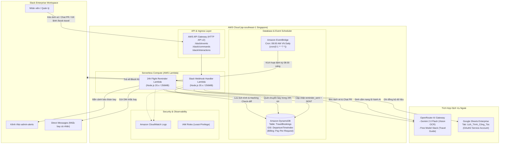

# KIẾN TRÚC HỆ THỐNG VÀ HƯỚNG DẪN TRIỂN KHAI AWS PRODUCTION
## Dự Án: Smart Travel Assistant (Corporate Travel Tracker)

---

## 1. TỔNG QUAN KIẾN TRÚC SERVERLESS EVENT-DRIVEN

Hệ thống được thiết kế theo mô hình **Cloud-Native Serverless Event-Driven Architecture** trên AWS, giúp doanh nghiệp tự động hóa 100% quy trình quản lý công tác với chi phí vận hành tối ưu (~0 USD trong gói AWS Free Tier) và độ sẵn sàng cao (High Availability 99.99%).



---

## 2. BẢNG ĐỐI CHIẾU MÔ HÌNH: LOCALSTACK (DEV) VS AWS CLOUD (PROD)

| Thành phần | Giai đoạn Phát triển Local (Dev) | Giai đoạn Vận hành AWS (Production) | Ưu điểm khi lên Production |
| :--- | :--- | :--- | :--- |
| **Cơ sở dữ liệu** | Docker LocalStack / DynamoDB Local (`localhost:4566`) | **Amazon DynamoDB (On-Demand)** | Tự động nhân bản đa vùng (Multi-AZ), sao lưu Point-in-time recovery |
| **Máy chủ xử lý** | `node slack_server.js` chạy trên máy cá nhân | **AWS Lambda Function (Node.js 20.x)** | Tự co giãn từ 0 đến hàng ngàn request đồng thời, không cần quản lý OS |
| **Đường hầm / Domain** | Pinggy SSH Tunnel (hết hạn mỗi 60 phút) | **AWS API Gateway (HTTP API v2)** | Cố định vĩnh viễn, bảo mật HTTPS tiêu chuẩn toàn cầu, độ trễ < 15ms |
| **Bộ lập lịch Cron** | Chạy file `reminder_worker.js` thủ công | **Amazon EventBridge Rules** | Tự động kích hoạt chính xác theo lịch biểu `cron(0 1 * * ? *)` |
| **Quản trị hạ tầng** | Docker Compose thủ công | **Terraform Infrastructure as Code (IaC)** | Tái tạo toàn bộ hệ sinh thái chỉ với 1 câu lệnh `terraform apply` |

---

## 3. CẤU TRÚC MÃ NGUỒN TERRAFORM VÀ LAMBDA

```
Smart Travel Assistant/
├── .github/
│   └── workflows/
│       └── deploy.yml              # CI/CD tự động Lint, Test, Plan & Deploy
├── lambda/
│   ├── common.js                   # Thư viện dùng chung (DynamoDB SDK, Google Sheets JWT, Slack API)
│   ├── ai_ocr_service.js           # Bóc tách vé máy bay bằng AI Vision & Phân tích Chat PR
│   ├── slack_handler.js            # Lambda xử lý Webhook từ Slack (Events, Commands, Modals)
│   └── reminder_cron.js            # Lambda quét chuyến bay 24h và gửi cẩm nang AI
├── terraform/
│   ├── main.tf                     # Cấu hình Terraform & AWS Provider
│   ├── variables.tf                # Khai báo các biến môi trường cấu hình
│   ├── dynamodb.tf                 # Khai báo bảng DynamoDB & GSI DepartureTimeIndex
│   ├── iam.tf                      # Khai báo IAM Role & Policy Least-Privilege
│   ├── lambda.tf                   # Đóng gói zip và khai báo 2 hàm Lambda
│   ├── api_gateway.tf              # Khai báo API Gateway HTTP API v2 & Routes
│   ├── eventbridge.tf              # Khai báo EventBridge Cron 08:00 AM VN
│   ├── outputs.tf                  # Xuất các URL để dán vào Slack App
│   └── terraform.tfvars.example    # Mẫu cấu hình giá trị biến bí mật
└── docs/
    └── ARCHITECTURE_AND_DEPLOYMENT_GUIDE.md
```

---

## 4. HƯỚNG DẪN TRIỂN KHAI LÊN AWS PRODUCTION (5 BƯỚC)

### Bước 1: Cài đặt công cụ và xác thực AWS CLI
Đảm bảo máy đã cài đặt **AWS CLI** và **Terraform (>= 1.5.0)**:
```bash
aws configure
# Nhập AWS Access Key ID, AWS Secret Access Key, Default region: ap-southeast-1
```

### Bước 2: Thiết lập file biến cấu hình bí mật
Vào thư mục `terraform/` và tạo file `terraform.tfvars` từ file mẫu:
```bash
cd terraform
cp terraform.tfvars.example terraform.tfvars
```
Điền đầy đủ thông tin:
- `slack_bot_token`: Token `xoxb-...` lấy từ Slack App.
- `slack_signing_secret`: Signing secret lấy từ Slack App Basic Information.
- `google_sheet_id`: ID của Google Sheet công tác.
- `google_service_account_json`: Chuỗi nội dung JSON của file `google-service-account.json`.
- `openrouter_api_key`: Khóa API OpenRouter AI.

### Bước 3: Khởi tạo và kiểm tra kế hoạch triển khai
```bash
terraform init
terraform plan
```

### Bước 4: Triển khai hạ tầng lên AWS
```bash
terraform apply -auto-approve
```
Sau khi hoàn tất, màn hình terminal sẽ xuất ra các đường dẫn cố định:
```text
Outputs:
api_gateway_endpoint       = "https://abc123xyz.execute-api.ap-southeast-1.amazonaws.com/"
slack_events_request_url   = "https://abc123xyz.execute-api.ap-southeast-1.amazonaws.com/slack/events"
slack_commands_request_url = "https://abc123xyz.execute-api.ap-southeast-1.amazonaws.com/slack/commands"
slack_interactions_request_url = "https://abc123xyz.execute-api.ap-southeast-1.amazonaws.com/slack/interactions"
dynamodb_table_name        = "TravelBookings"
```

### Bước 5: Cập nhật URL vĩnh viễn lên Slack Dashboard
Truy cập [Slack API App Dashboard](https://api.slack.com/apps):
1. **Event Subscriptions** ➔ Dán `slack_events_request_url` (Hiện tick xanh Verified).
2. **Interactivity & Shortcuts** ➔ Dán `slack_interactions_request_url`.
3. **Slash Commands** ➔ Chỉnh sửa `/book-travel` và dán `slack_commands_request_url`.

🎉 **Hoàn tất!** Hệ thống đã hoạt động vĩnh viễn trên AWS mà không phụ thuộc vào bất kỳ máy tính cá nhân hay đường hầm nào.

---

## 5. BÁO CÁO DỰ TOÁN CHI PHÍ HÀNG THÁNG (AWS COST ESTIMATION)

Hệ thống được thiết kế hoàn toàn theo tiêu chuẩn **Pay-As-You-Go / Free Tier**:

| Dịch vụ AWS | Mức sử dụng ước tính (Doanh nghiệp 50-200 nhân sự) | Chi phí / Tháng |
| :--- | :--- | :--- |
| **AWS Lambda** | ~10,000 lượt gọi / tháng (Miễn phí 1,000,000 lượt/tháng) | **$0.00** |
| **Amazon DynamoDB** | < 100 MB dữ liệu lưu trữ (Miễn phí 25 GB/tháng) | **$0.00** |
| **AWS API Gateway** | ~10,000 HTTP requests / tháng (Miễn phí 1,000,000 req trong 12 tháng đầu) | **$0.00** |
| **Amazon EventBridge** | 30 lượt kích hoạt / tháng | **$0.00** |
| **CloudWatch Logs** | ~200 MB log / tháng (Miễn phí 5 GB/tháng) | **$0.00** |
| **OpenRouter AI** | Model `@preset/free-model-stack` & `gemini-2.0-flash-exp:free` | **$0.00** |
| **TỔNG CHI PHÍ DỰ KIẾN** | **Hệ thống tự động hóa hoàn chỉnh** | **$0.00 USD / tháng** |

---

## 6. TIÊU CHUẨN BẢO MẬT DOANH NGHIỆP (ENTERPRISE SECURITY)

1. **Least-Privilege IAM Access**: Các hàm Lambda chỉ được cấp quyền truy cập duy nhất vào bảng DynamoDB `TravelBookings`, không có quyền can thiệp vào bất kỳ tài nguyên nào khác của tài khoản AWS.
2. **KMS Server-Side Encryption**: Toàn bộ dữ liệu đặt vé máy bay và thông tin CCCD/Passport trên DynamoDB được mã hóa tĩnh (Encryption at Rest) bằng khóa KMS do AWS quản lý.
3. **Audit Hash Integrity**: Mỗi bản ghi chuyến bay đều được gắn mã băm SHA-256 (`row_hash`). Mọi hành vi chỉnh sửa trái phép từ bảng tính đều sẽ bị phát hiện và cảnh báo tức thì vào kênh `#biz-admin-alerts`.
4. **Zero-Trust Webhook Verification**: Toàn bộ request từ Slack gửi tới AWS API Gateway được xác thực thông qua chữ ký mật mã HMAC-SHA256 (`x-slack-signature`) nhằm ngăn chặn tấn công giả mạo (Man-in-the-Middle) và tấn công phát lại (Replay Attack).

