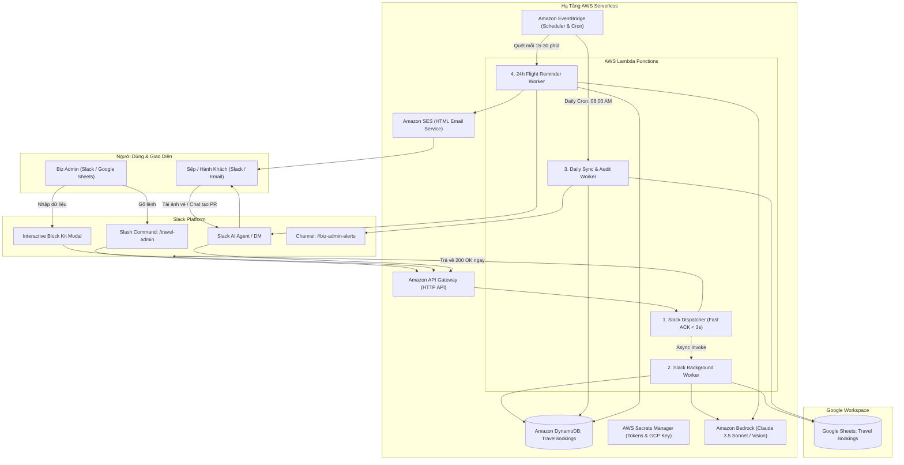

# PROJECT PROPOSAL: SMART TRAVEL ASSISTANT (TRAVEL TRACKER)

## Hệ Thống Quản Trị & Trợ Lý Lịch Trình Công Tác Tự Động Hóa Qua Slack & Generative AI

---

| **Thuộc tính**                         | **Chi tiết**                                                                                                                                                                        |
| :--------------------------------------------- | :----------------------------------------------------------------------------------------------------------------------------------------------------------------------------------------- |
| **Tên dự án**                         | **Smart Travel Assistant** (Mã hiệu: `STA-2026`)                                                                                                                                 |
| **Project Lead / Tech Lead**             | Triệu  Hào                                                                                                                                                                             |
| **Khách hàng nội bộ (Stakeholders)** | Đội ngũ Biz Admin (Văn phòng / Nhân sự) & Ban Giám Đốc (C-Level / Executives)                                                                                                    |
| **Công nghệ cốt lõi**                | AWS Serverless (Lambda, DynamoDB, EventBridge, API Gateway, SES), Amazon Bedrock (Claude 3.5 Sonnet / Vision), Slack Platform (Bolt, Block Kit, Modals, Assistant View), Google Sheets API |
| **Thời gian triển khai**               | 5 Ngày (Sprint MVP) / 2 Tuần (Hoàn thiện UAT & Go-Live)                                                                                                                                |
| **Mức độ khả thi**                   | **9.2 / 10** (Rất cao - Dựa trên các dịch vụ Cloud tiêu chuẩn công nghiệp)                                                                                                 |

---

## 1. TỔNG QUAN DỰ ÁN (EXECUTIVE SUMMARY)

### 1.1. Bối cảnh & Vấn đề Doanh nghiệp (The Business Problem)

Hiện tại, việc quản lý lịch trình công tác của các Lãnh đạo và Quản lý cấp cao đang được thực hiện thủ công thông qua một file Google Sheets duy nhất. Phương thức này đang gây ra các tắc nghẽn nghiêm trọng:

1. **Lãng phí thời gian vận hành:** Biz Admin mất từ 15 đến 20 giờ mỗi tháng cho các tác vụ lặp đi lặp lại: nhập liệu thông tin vé, rà soát đối chiếu, soạn thảo email nhắc lịch và gửi tin nhắn thủ công.
2. **Sai sót dữ liệu ảnh hưởng kiểm toán:** Người nhập liệu dễ gõ sai định dạng ngày giờ, nhầm lẫn mã sân bay IATA, quên điền mã vé PNR hoặc mã số Purchase Request (PR). Đến kỳ kiểm toán chi phí công tác, việc đối chiếu chứng từ tốn rất nhiều công sức.
3. **Trải nghiệm rời rạc cho Lãnh đạo:** Các Sếp phải tự lục tìm email/vé máy bay trong hộp thư đến vào giờ bay, không có kênh tóm tắt nhanh về checklist hành lý hoặc thông tin địa phương điểm đáp.
4. **Chưa khai thác hạ tầng sẵn có:** Toàn bộ doanh nghiệp đã sử dụng **Slack** làm kênh giao tiếp nội bộ chính, nhưng các nghiệp vụ liên quan đến công tác vẫn đang xử lý rời rạc qua Google Sheet và email cá nhân.

### 1.2. Giải pháp Đề xuất (Proposed Solution)

Xây dựng **Smart Travel Assistant** — một giải pháp tự động hóa luồng công việc (Workflow Automation) kết hợp Trợ lý Trí tuệ Nhân tạo Đa phương thức (Multimodal Generative AI) chạy trực tiếp trên Slack:

* **Đồng bộ dữ liệu hai chiều tự động:** Kết nối Google Sheets với Amazon DynamoDB thông qua EventBridge Cronjob và AWS Lambda, tự động kiểm tra khác biệt (diff checking) và băm dữ liệu không để xảy ra trùng lặp.
* **Kiểm toán dữ liệu tự động hằng ngày:** Tự động phát hiện các dòng thiếu thông tin, sai format ngày giờ, sai mã IATA và bắn báo cáo tổng hợp vào kênh Slack của Biz Admin mỗi sáng.
* **Giao diện quản trị tương tác tức thì trên Slack:** Biz Admin có thể dùng lệnh `/travel-admin` để mở Slack Interactive Modal, thêm/sửa chuyến đi trực tiếp mà không cần mở Google Sheet.
* **Nhắc lịch thông minh trước 24h & Cẩm nang AI:** Tự động quét các chuyến bay sắp cất cánh trong 24h tới để bắn đồng thời Email HTML và tin nhắn Slack DM cho hành khách; sử dụng **Amazon Bedrock (Claude 3.5 Sonnet)** để tạo checklist đồ cần mang và cẩm nang ẩm thực/danh lam thắng cảnh tại điểm đáp dựa trên mã IATA.
* **Trợ lý Slack AI Agent & OCR vé máy bay:** Cho phép người dùng chat tự nhiên để tạo Purchase Request hoặc chỉ cần kéo thả ảnh chụp vé máy bay lên Slack; mô hình Vision AI sẽ tự động đọc hiểu và bóc tách thành dữ liệu có cấu trúc để ghi vào hệ thống.

---

## 2. MỤC TIÊU DỰ ÁN & CHỈ SỐ ĐO LƯỜNG (OBJECTIVES & SUCCESS KPIS)

Dự án áp dụng mô hình mục tiêu **SMART**:

```
[Tiết kiệm 80% thời gian Biz Admin] ──► [0 lỗi sai format kiểm toán] ──► [100% chuyến bay được nhắc lịch]
```

### Chỉ số Đo lường Hiệu quả (KPIs):

| Chỉ số (KPI)                                          |          Hiện trạng (As-Is)          |                  Mục tiêu sau dự án (To-Be)                  | Phương pháp đo lường                         |
| :------------------------------------------------------ | :-------------------------------------: | :---------------------------------------------------------------: | :------------------------------------------------- |
| **Thời gian nhập liệu & nhắc lịch**          |          15 - 20 giờ / tháng          |             **< 3 giờ / tháng** (Giảm ~80%)             | Khảo sát nhật ký công việc của Biz Admin.   |
| **Tỷ lệ lỗi sai format dữ liệu**             |     12 - 18% số dòng trên Sheet     | **0%** (Chặn ngay từ Slack Modal & Báo lỗi hằng ngày) | Log quét của hệ thống Validator.               |
| **Tỷ lệ chuyến bay được nhắc trước 24h** | ~60% (Phụ thuộc vào trí nhớ Admin) |                     **100% tự động**                     | EventBridge execution logs & DynamoDB audit flags. |
| **Thời gian trích xuất thông tin vé**        |       3 - 5 phút / vé (gõ tay)       |         **< 10 giây / vé** (Upload ảnh lên Bot)         | Amazon Bedrock Vision response time.               |

---

## 3. PHẠM VI DỰ ÁN (PROJECT SCOPE)

### 3.1. Trong phạm vi (In-Scope — Giai đoạn MVP)

* Thiết lập kết nối bảo mật giữa AWS Lambda và Google Sheets qua Google Cloud Service Account.
* Bảng cơ sở dữ liệu Amazon DynamoDB lưu trữ chuyến bay, lịch sử đồng bộ và cờ trạng thái nhắc lịch.
* Pipeline kiểm tra dữ liệu tự động hằng ngày (Data Validator bằng Pydantic) và gửi báo cáo lỗi về Slack Webhook `#biz-admin-alerts`.
* Slack Slash Command (`/travel-admin`) và Interactive Modal (Slack Block Kit) để Admin thao tác dữ liệu và chạy trigger test.
* Cronjob quét chuyến bay trước 24h, tích hợp Amazon SES gửi email HTML và Slack WebClient gửi DM.
* Tích hợp Amazon Bedrock (Claude 3.5 Sonnet) để sinh nội dung cẩm nang địa phương dựa vào mã IATA điểm đáp.
* Luồng Slack Bot nhận ảnh chụp vé máy bay/boarding pass, gọi Bedrock Multimodal Vision để bóc tách thông tin và hiển thị xác nhận cho người dùng.
* Luồng hội thoại chat thu thập thông tin tạo Purchase Request (PR).

### 3.2. Ngoài phạm vi (Out-of-Scope — Dành cho Phase 2)

* Tích hợp trực tiếp cổng thanh toán hoặc hệ thống ngân hàng để xuất vé tự động.
* Kết nối API bán vé máy bay thời gian thực của các Global Distribution Systems (như Amadeus, Sabre) để đặt chỗ tự động.
* Đồng bộ hai chiều với các phần mềm ERP lớn của doanh nghiệp (SAP, Oracle, Odoo). *(Giai đoạn này dữ liệu xuất ra Google Sheets/CSV đã đủ chuẩn để bộ phận kế toán sử dụng).*

---

## 4. KIẾN TRÚC HỆ THỐNG & CÔNG NGHỆ (TECHNICAL ARCHITECTURE)

### 4.1. Sơ đồ Kiến trúc Tổng thể (System Architecture Diagram)



### 4.2. Giải pháp Kỹ thuật Trọng yếu (Key Engineering Patterns)

> [!IMPORTANT]
> **Giải quyết triệt để quy tắc 3-second Timeout của Slack:**Slack yêu cầu mọi Webhook từ Slash Command, Interactive Component hoặc Event Subscription phải nhận được phản hồi HTTP `200 OK` trong vòng **dưới 3 giây**. Các tác vụ như gọi Bedrock Vision OCR hoặc ghi Google Sheets thường mất từ 4 - 8 giây.**Giải pháp:** Áp dụng mô hình **Decoupled Async Pattern**:
>
> 1. `travel-slack-dispatcher-fn`: Nhận request, xác thực chữ ký `X-Slack-Signature`, trả về HTTP 200 OK kèm payload tạm (hoặc mở modal trống) chỉ trong **~200ms**.
> 2. Kích hoạt bất đồng bộ (Asynchronous Invocation) cho `travel-slack-worker-fn` để thực hiện xử lý nặng trong nền (gọi Bedrock, Google Sheets API, DynamoDB).
> 3. Sau khi xử lý xong, worker cập nhật lại giao diện Slack bằng `response_url` hoặc API `chat.update` / `views.update`.

> [!TIP]
> **Thuật toán Check Diff thông minh giữa Google Sheets & DynamoDB:**
> Mỗi dòng trên Google Sheet được băm (hashing bằng SHA-256) dựa trên nội dung các cột:
> `row_hash = SHA256(Trip_ID + Flight_Code + Departure_Time + Cost + PNR)`
> Khi cronjob chạy, Lambda so sánh `row_hash` mới tính với `row_hash` đã lưu trong DynamoDB. Nếu giống nhau $\rightarrow$ bỏ qua (tiết kiệm số lượt Write Capacity Units của DynamoDB). Nếu khác nhau $\rightarrow$ thực hiện cập nhật và ghi nhận lịch sử thay đổi.

---

## 5. KẾ HOẠCH TRIỂN KHAI CHI TIẾT (WORK BREAKDOWN STRUCTURE - WBS)

Dự án được phân chia thành **5 Sprint / Giai đoạn thực thi độc lập**, có thể hoàn thành trong 5 ngày tập trung:

```
[Sprint 1: Core Sync & Audit] ──► [Sprint 2: Slack Admin UI] ──► [Sprint 3: 24h AI Reminder] ──► [Sprint 4: Bedrock OCR & Agent] ──► [Sprint 5: E2E & Go-Live]
```

### Sprint 1: Thiết Lập Hạ Tầng Cloud, Google Sheets Sync & Báo Cáo Kiểm Toán

* **Mục tiêu:** Xây dựng luồng dữ liệu nền tảng giữa Google Sheets và DynamoDB; tự động phát hiện và cảnh báo lỗi nhập liệu.
* **Các công việc cụ thể:**
  1. Khởi tạo Google Cloud Project, kích hoạt Google Sheets API & Google Drive API; tạo Service Account và cấp quyền Editor vào file Google Sheet mẫu.
  2. Tạo secret trên **AWS Secrets Manager** lưu trữ file JSON Service Account và Slack Webhook URL.
  3. Viết mã nguồn AWS SAM (`template.yaml`) khởi tạo bảng DynamoDB `TravelBookings` (Partition Key: `trip_id`, GSI: `DepartureTimeIndex`).
  4. Xây dựng Data Validator module bằng **Pydantic** (`models.py`) để kiểm tra: regex mã chuyến bay, mã IATA chuẩn 3 ký tự, định dạng ngày giờ ISO 8601, giá vé số dương.
  5. Viết Lambda `travel-sheet-sync-fn`: Đọc toàn bộ Sheet, tính mã băm `row_hash`, kiểm tra diff, ghi các dòng mới/thay đổi vào DynamoDB.
  6. Thiết lập EventBridge Rule chạy lúc 08:00 sáng mỗi ngày, tổng hợp các dòng vi phạm format và bắn báo cáo vào Slack channel `#biz-admin-alerts`.
* **Tiêu chí nghiệm thu (DoD):**
  - Chạy thử sync thành công với file Sheet mẫu.
  - Các dòng cố tình nhập sai (sai ngày giờ, sai mã IATA) được phát hiện chính xác 100% và gửi tin nhắn cảnh báo định dạng đẹp mắt về Slack channel.

---

### Sprint 2: Xây Dựng Slack App, Slash Command & Interactive Modal Cho Biz Admin

* **Mục tiêu:** Cung cấp giao diện trực quan ngay trên Slack để Biz Admin nhập liệu hoặc chỉnh sửa chuyến đi mà không cần vào Google Sheet.
* **Các công việc cụ thể:**
  1. Khởi tạo ứng dụng trên `api.slack.com/apps`, cấu hình OAuth Scopes (`commands`, `chat:write`, `im:write`, `files:read`).
  2. Tạo Slash Command `/travel-admin` trỏ về API Gateway Endpoint `POST /slack/interactions`.
  3. Thiết kế giao diện **Slack Block Kit Interactive Modal** gồm:
     - Dropdown chọn Sếp / Nhân viên đi công tác.
     - Ô nhập số hiệu chuyến bay, Datepicker chọn ngày bay, Timepicker chọn giờ bay.
     - Dropdown chọn sân bay đi và sân bay đến (chuẩn hóa sẵn mã IATA để triệt tiêu lỗi gõ tay).
     - Nút bấm `[Chạy Test Sync & Bắn Thử Reminder]`.
  4. Viết Lambda xử lý khi Admin bấm **Submit Modal**: Ghi đồng thời vào dòng tương ứng trên Google Sheets và cập nhật DynamoDB.
* **Tiêu chí nghiệm thu (DoD):**
  - Admin gõ `/travel-admin` trên Slack hiển thị modal trong vòng < 1 giây.
  - Điền form và bấm Submit $\rightarrow$ dữ liệu lập tức xuất hiện trên Google Sheet và DynamoDB.

---

### Sprint 3: Hệ Thống Nhắc Lịch 24h & Amazon Bedrock AI Travel Guide

* **Mục tiêu:** Tự động gửi thông tin chuyến đi cá nhân hóa cho Sếp đúng 24h trước giờ cất cánh.
* **Các công việc cụ thể:**
  1. Cấu hình **Amazon SES**: Xác thực domain công ty hoặc email gửi đi, thiết kế mẫu Responsive HTML Email chuyên nghiệp (Flight itinerary, luggage checklist, local guide).
  2. Xây dựng module tích hợp **Amazon Bedrock (Claude 3.5 Sonnet)**:
     - Prompt Engineering: Nhận đầu vào là `arrival_iata`, thời gian lưu trú và mục đích chuyến đi.
     - Output cấu trúc: (1) Danh sách vật dụng cần chuẩn bị (passport, visa, trang phục theo mùa), (2) Top 3 địa điểm ẩm thực/đặc sản địa phương nổi bật, (3) Lưu ý khi hạ cánh tại sân bay đích.
  3. Viết Lambda `travel-reminder-24h-fn`:
     - EventBridge Schedule kích hoạt mỗi 15-30 phút.
     - Query DynamoDB GSI `DepartureTimeIndex` tìm các chuyến bay có giờ khởi hành nằm trong khoảng $[T+23.5h, T+24.5h]$ và `reminder_sent = False`.
     - Gọi Bedrock tạo nội dung cẩm nang.
     - Gửi email qua SES và gửi tin nhắn riêng (DM) vào tài khoản Slack của người bay qua API `chat.postMessage`.
     - Cập nhật cờ `reminder_sent = True` trên DynamoDB và Sheet.
* **Tiêu chí nghiệm thu (DoD):**
  - Chuyến bay có giờ khởi hành cách thời điểm hiện tại 24h được quét trúng.
  - Sếp nhận được email HTML chuẩn đẹp trong hộp thư và tin nhắn Slack DM chứa cẩm nang điểm đến do AI sinh ra.

---

### Sprint 4: Slack AI Assistant, OCR Vé Máy Bay & Luồng Tạo Purchase Request (PR)

* **Mục tiêu:** Tận dụng Multimodal GenAI để bóc tách thông tin từ vé máy bay và hỗ trợ chat tạo PR tự nhiên.
* **Các công việc cụ thể:**
  1. Bật tính năng **Assistant / Agent** cho Slack Bot, đăng ký Event Subscription `message.im` và `file_shared`.
  2. Xây dựng luồng **Multimodal Ticket OCR**:
     - Người dùng kéo thả ảnh chụp vé máy bay hoặc file e-ticket PDF vào khung chat với Bot.
     - Lambda tải file tạm về S3 qua Slack Bot Token, chuyển file thành Base64 và gọi **Amazon Bedrock Vision (Claude 3.5 Sonnet)**.
     - Prompt yêu cầu trả về định dạng JSON thuần: `passenger_name`, `airline`, `flight_number`, `pnr`, `departure_iata`, `arrival_iata`, `departure_time`, `ticket_price`.
  3. Render **Preview Card (Block Kit)** trong khung chat hiển thị toàn bộ thông tin AI vừa đọc được kèm 2 nút: `[✅ Xác Nhận & Lưu Chuyến Đi]` và `[✏️ Sửa Thông Tin]`. Khi bấm xác nhận mới chính thức lưu vào hệ thống.
  4. Xây dựng kịch bản hội thoại **Tạo Purchase Request (PR)**:
     - Sếp chat: *"Tạo PR cho chuyến đi công tác Hà Nội tuần sau, dự trù 5 triệu vé máy bay"*.
     - Bot hỏi các thông tin còn thiếu $\rightarrow$ tạo bản ghi trạng thái `PENDING` $\rightarrow$ gửi tin nhắn kèm nút `[Phê Duyệt]` / `[Từ Chối]` vào channel `#biz-admin-approvals`.
* **Tiêu chí nghiệm thu (DoD):**
  - Thả ảnh vé máy bay của các hãng (Vietnam Airlines, Vietjet...) lên Slack, Bot đọc chính xác các trường chính trong < 10 giây.
  - Bấm xác nhận, thông tin được điền tự động vào Google Sheets và DynamoDB.

---

### Sprint 5: Kiểm Thử Tích Hợp (E2E), Xử Lý Edge Cases, UAT & Bàn Giao

* **Mục tiêu:** Đảm bảo hệ thống đạt độ ổn định cao nhất, không lỗi gián đoạn và sẵn sàng bàn giao cho người dùng.
* **Các công việc cụ thể:**
  1. Kiểm thử trọn vẹn kịch bản đầu cuối (End-to-End Testing):
     - Upload vé $\rightarrow$ Xác nhận $\rightarrow$ Sheet cập nhật $\rightarrow$ Admin sửa thông tin qua Slack Modal $\rightarrow$ Quét kiểm toán $\rightarrow$ Bắn nhắc lịch 24h.
  2. Tối ưu xử lý các trường hợp ngoại lệ (Edge Cases):
     - Múi giờ sân bay quốc tế (quy đổi chuẩn xác về UTC khi lưu trữ).
     - Xử lý Rate Limit của Google Sheets API khi có nhiều request đồng thời (thêm Exponential Backoff & Retry).
     - Xử lý ảnh vé chụp bị mờ hoặc thiếu thông tin: Bot phản hồi lịch sự hướng dẫn người dùng tải lại ảnh rõ hơn.
  3. Soạn tài liệu Hướng Dẫn Sử Dụng Nhanh (User Guide) gồm ảnh chụp minh họa thao tác cho Biz Admin và Lãnh đạo.
  4. Buổi nghiệm thu nội bộ (User Acceptance Testing - UAT) và chuyển giao.
* **Tiêu chí nghiệm thu (DoD):**
  - 100% test cases trong bảng kịch bản chạy thành công.
  - Tài liệu hướng dẫn sử dụng hoàn chỉnh.

---

## 6. QUẢN TRỊ RỦI RO DỰ ÁN (RISK MANAGEMENT MATRIX)

| Rủi ro tiềm ẩn (Risk)                                                                    |  Khả năng / Mức độ  |                                                                   Biện pháp phòng ngừa & Xử lý (Mitigation Strategy)                                                                   |  |
| :------------------------------------------------------------------------------------------ | :-----------------------: | :------------------------------------------------------------------------------------------------------------------------------------------------------------------------------------------: | :- |
| **Slack 3-second Timeout** khiến bot báo lỗi "operation_timeout" trên giao diện. |         Cao / Cao         |                           Thiết kế tầng Ingress Dispatcher trả lời `200 OK` ngay lập tức (< 300ms) rồi mới gọi Lambda Worker xử lý ngầm trong nền.                           |  |
| **Google Sheets API Rate Limit** (Giới hạn 300 req/min/project).                    | Trung bình / Trung bình |              Chỉ đọc/ghi theo từng batch (dùng `batch_update`), không gọi API theo từng cell; tận dụng DynamoDB làm cache để hạn chế đọc Sheet nhiều lần.              |  |
| **Xung đột dữ liệu (Concurrent Edits)** khi nhiều người sửa cùng lúc.       |    Thấp / Trung bình    |                    Áp dụng khóa lạc quan (Optimistic Locking) trên DynamoDB và sử dụng mã định danh duy nhất `Trip_ID` cho từng dòng trên Google Sheet.                    |  |
| **Lệch múi giờ chuyến bay quốc tế** khiến nhắc lịch 24h bị sai giờ.        |     Trung bình / Cao     |                      Lưu trữ trường `departure_time_utc` trong DynamoDB làm chuẩn so sánh cho Scheduler, chỉ hiển thị giờ địa phương trên giao diện.                      |  |
| **Bảo mật dữ liệu cá nhân (PII)** trên vé máy bay (Số hộ chiếu/CCCD).     |      Cao / Rất cao      | Phân quyền nghiêm ngặt trên AWS S3 (chỉ lưu ảnh tạm thời trong 24h rồi tự động xóa qua S3 Lifecycle Policy); chỉ các Admin có quyền mới được vào channel quản trị. |  |

---

## 7. DỰ TOÁN NGÂN SÁCH & CHI PHÍ VẬN HÀNH (BUDGET ESTIMATION)

Hệ thống được thiết kế theo kiến trúc **Cloud Native Serverless (Pay-as-you-go)**. Đối với quy mô doanh nghiệp vừa và nhỏ (~50 đến 500 nhân sự, tần suất ~100 chuyến bay/tháng):

| Dịch vụ AWS                                    | Mức sử dụng dự kiến / tháng                                                         |                         Chi phí ước tính                         | Ghi chú                                                                                    |
| :----------------------------------------------- | :---------------------------------------------------------------------------------------- | :-------------------------------------------------------------------: | :------------------------------------------------------------------------------------------ |
| **AWS Lambda**                             | ~15,000 invocations                                                                       |                            **$0.00**                            | Nằm trọn trong AWS Free Tier (1 triệu requests/tháng miễn phí).                       |
| **Amazon DynamoDB**                        | ~50,000 Read/Write Units, < 100MB data                                                    |                            **$0.00**                            | Nằm trọn trong AWS Free Tier (25GB miễn phí).                                           |
| **Amazon EventBridge**                     | ~3,000 schedule triggers                                                                  |                            **$0.00**                            | Miễn phí trong hạn mức.                                                                 |
| **Amazon API Gateway**                     | ~5,000 HTTP requests                                                                      |                            **$0.01**                            | Hầu như không đáng kể ($1.00 / 1 triệu requests).                                    |
| **Amazon SES**                             | ~100 - 200 emails / tháng                                                                |                            **$0.02**                            | $0.10 cho mỗi 1,000 emails.                                                                |
| **Amazon Bedrock (Claude 3.5 Sonnet)**     | 100 lần OCR vé + 100 lần sinh cẩm nang IATA (~300k input tokens + 150k output tokens) |                        **$1.80 - $2.50**                        | Chi phí trả trực tiếp theo token thực tế sử dụng.                                   |
| **Tổng chi phí vận hành hàng tháng** |                                                                                           | **~ $2.00 - $3.00 USD / tháng** (Khoảng 50,000 - 75,000 VNĐ) | **Cực kỳ tiết kiệm, ROI vượt trội so với mua phần mềm SaaS chuyên biệt.** |

---

## 8. MA TRẬN PHÂN CÔNG TRÁCH NHIỆM (RACI MATRIX)

* **R (Responsible):** Người trực tiếp thực hiện công việc.
* **A (Accountable):** Người chịu trách nhiệm phê duyệt cuối cùng.
* **C (Consulted):** Người được hỏi ý kiến / tham vấn chuyên môn.
* **I (Informed):** Người nhận thông báo kết quả.

| Hạng mục công việc (Work Items)                 | Tech Lead (Nguyễn Tuấn Hào) | Biz Admin Lead | C-Level Sponsor | Kế toán nội bộ |
| :-------------------------------------------------- | :----------------------------: | :-------------: | :-------------: | :----------------: |
| Phê duyệt Proposal & Kiến trúc hệ thống       |        **R / A**        |   **C**   |   **A**   |    **I**    |
| Thiết kế Schema Google Sheet & DynamoDB           |        **R / A**        |   **C**   |   **I**   |    **C**    |
| Cấu hình tài khoản AWS & Google Cloud           |        **R / A**        |   **I**   |   **I**   |    **I**    |
| Xây dựng Slack Bot, Modals & Bedrock AI           |        **R / A**        |   **C**   |   **I**   |    **I**    |
| Đánh giá thử nghiệm kiểm toán lỗi dữ liệu |          **R**          | **A / C** |   **I**   |    **C**    |
| Thử nghiệm tính năng OCR vé & Reminder 24h     |          **R**          |   **A**   |   **C**   |    **I**    |
| Nghiệm thu UAT & Bàn giao hệ thống chính thức |          **R**          |   **A**   |   **A**   |    **I**    |

---

## 9. KẾ HOẠCH HÀNH ĐỘNG NGAY LẬP TỨC (IMMEDIATE NEXT STEPS)

Để bắt đầu dự án một cách thuận lợi, 3 bước hành động đầu tiên cần triển khai:

1. **Khởi tạo và chia sẻ Google Sheet chuẩn:** Sử dụng cấu trúc từ file mẫu **`Smart_Travel_Tracker_Sample.xlsx`** vừa tạo để làm sheet gốc.
2. **Khởi tạo Google Cloud Service Account:** Tạo key JSON và chia sẻ quyền Editor của Google Sheet cho địa chỉ email của Service Account.
3. **Triển khai khung mã nguồn AWS SAM (`template.yaml`):** Tạo các tài nguyên cơ bản trên AWS (DynamoDB Table, Secrets Manager, IAM Roles) để bắt đầu viết code cho Sprint 1.

---

*Tài liệu Proposal được soạn thảo bởi **Project Lead: Nguyễn Tuấn Hào** — Sẵn sàng cho giai đoạn thực thi Sprint 1.*
